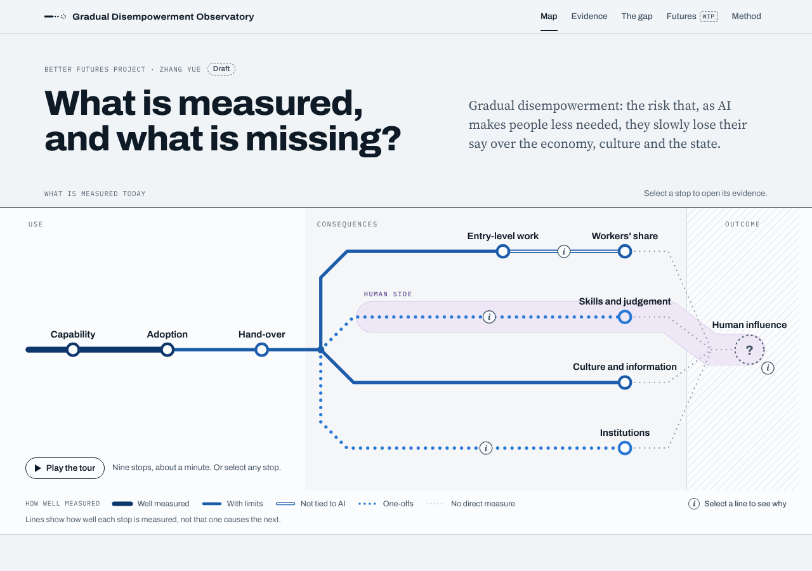
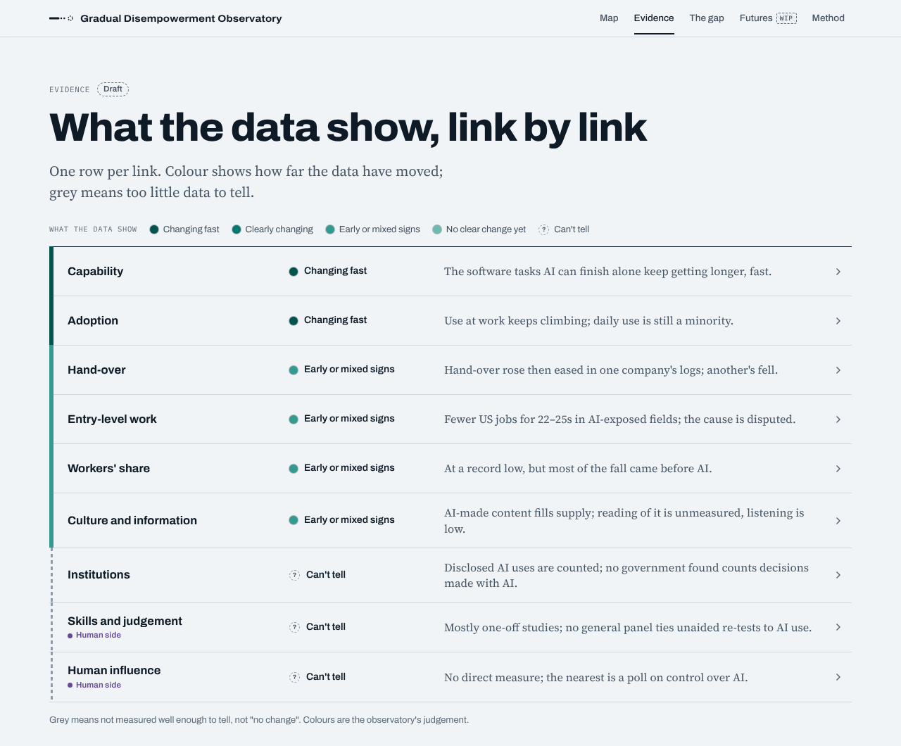
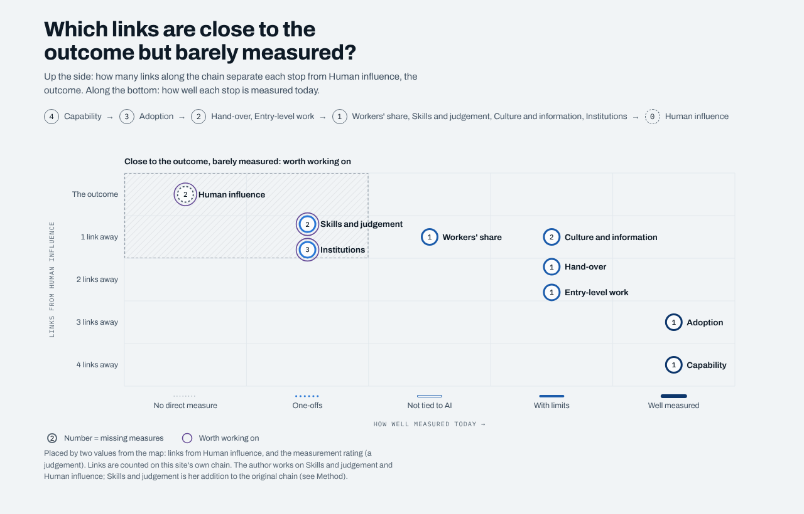

# Gradual Disempowerment Observatory

A draft website that maps what is measured about gradual disempowerment, link by link, and where the human side goes unmeasured.



**Status: draft v0.4 (8 October 2026).** The research and figures were compiled with AI research assistance and have not yet been checked by a person. Every chart says how its figures were obtained and links to its source. Check the source before citing a figure. A checklist of the headline figures to verify is in [`research/checklist/handcheck.csv`](research/checklist/handcheck.csv).

## What it shows

Gradual disempowerment is the risk that, as AI makes people less needed, they slowly lose their say over the economy, culture and the state ([Kulveit and co-authors, 2025](https://gradual-disempowerment.ai/)).

The site breaks that argument into a chain of nine stops: capability, adoption, hand-over, then four branches (entry-level work and workers' share, skills and judgement, culture and information, institutions), ending at human influence. For each stop it asks what is measured, what the data show, what a sceptic would say, what nobody measures and what to watch.

The main finding: what AI can do and who uses it are measured again and again. Whether people keep their skills, judgement and say is rarely measured, and almost never on the same people over time.

| Page | What it answers |
|---|---|
| **Map** (home) | What is measured, and what is missing? A guided tour walks through the nine stops. |
| **Evidence** | What the data show for each link, on one colour scale, plus a record of every dated reading since 2021. |
| **Link pages** | The indicators behind each link, each opening its own chart. |
| **The gap** | Which stops are close to the outcome but barely measured, and fourteen missing measures. |
| **Futures** | Published forecasts, mostly about US jobs and income. Work in progress. |
| **Method** | How the ratings are reached, how to read the charts, known limits and all sources. |

<table><tr>
<td></td>
<td></td>
</tr></table>

## View it

- **Online:** once GitHub Pages is switched on (see below), the site is at `https://<your-username>.github.io/gd-observatory/`.
- **On your computer:** open `docs/index.html` in a browser. It is one self-contained file.

To switch on GitHub Pages: in the repository, go to **Settings → Pages**, set **Source** to "Deploy from a branch", pick branch `main` and folder `/docs`, and save.

## Build it

The site is plain HTML, CSS and JavaScript with no framework. The build joins the files in `src/` into one page.

```sh
sh build.sh            # writes docs/index.html
sh build.sh artifact   # writes dist/artifact.html, for publishing as a Claude artifact
```

Optional checks (needs Node.js):

```sh
npm install
npx playwright install chromium
npm run verify         # every page at desktop and phone widths, light and dark
```

## Where things live

```
src/
  copy.js          all page text (headlines, card labels, gap items, method)
  data1.js         indicators for capability, adoption, hand-over, entry-level work
  data2.js         indicators for workers' share, skills, culture, institutions, human influence
  data3.js         futures scenarios, routes, missing measures, rating rubric, glossary
  signals.js       "what the data show" ratings per link, and the trend word per indicator
  charts.js        hand-written SVG chart kit (line, bars, record strip, and more)
  app.js           router, measurement record, shared charts
  components.js    map, tour, evidence rows, indicator cards, insight cards, gap matrix, caveat chips
  views.js         the pages
  style.css, components.css, pages.css
  shell_head.html, shell_body.html
docs/index.html    the built site (served by GitHub Pages)
research/          how the evidence was gathered and checked (see research/README.md)
tools/             verification and screenshot scripts
```

To change a figure, edit the indicator in `data1.js` or `data2.js` (its chart data, `title`, `read` and `src`), then any matching text in `copy.js`, then rebuild.

## How it was made

The evidence was gathered and checked with an AI-assisted research workflow: parallel research passes per domain, spot checks against primary sources, then several rounds of fact-checking, copy-editing, design critique and red-teaming. The notes and reviews are in [`research/`](research/README.md), so every rating can be traced back to its evidence.

## Corrections

Corrections and suggestions are welcome. Please open an issue with the page, the figure, and a link to the source.

## Licence

- Code (`src/`, `tools/`, `build.sh`): [MIT](LICENSE).
- Content (page text, data compilations and everything in `research/`): [CC BY 4.0](LICENSE-CONTENT.md). Reuse freely with credit.

Figures and quotations from third-party sources remain the property of their publishers; each is linked to its source.

## Cite as

Zhang Yue (2026). *Gradual Disempowerment Observatory* (draft v0.4). Better Futures Project.
